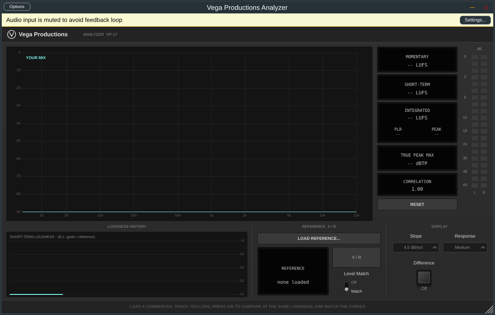

# Vega Productions Analyzer (VP-17)

Spectrum, loudness and reference-track A/B for matching commercial house releases.



## Download
- **Windows (FL Studio):** https://github.com/DJVega70/-vega-analyzer/releases/latest/download/VegaProductions-Analyzer-Windows-VST3.zip
- **macOS:** https://github.com/DJVega70/-vega-analyzer/releases/latest/download/VegaProductions-Analyzer-macOS-VST3-AU.zip

Put it **last** on the master (after Vega Productions Mastering).

## Features
- **Spectrum analyzer** (8192-point FFT) with peak hold, Fast/Medium/Slow response and 0 / 3 / 4.5 dB-per-octave slope (4.5 makes a balanced mix look flat).
- **Loudness (ITU-R BS.1770 / EBU R128):** Momentary, Short-term and gated Integrated LUFS, sample peak, **true peak** (8x inter-sample), PLR, correlation, 30-second loudness history.
- **Reference track:** load a WAV / AIFF / FLAC / OGG / MP3. Its average spectrum is drawn in gold over your mix, and its loudness and true peak are shown.
- **A/B with Level Match:** press A/B to hear the reference through your monitoring chain, turned down/up to your mix's loudness so you compare tone, not volume.
- **Difference curve:** shows where the reference has more or less energy than your mix (1/3-octave) — a map for your EQ moves.
- Audio passes through untouched (except while listening to the reference). The reference file is remembered with your project.

## Building
```
cmake -B build -DVEGA_TESTS=ON
cmake --build build --config Release --target VegaAnalyzer_VST3 VegaAnalyzerTest
```
